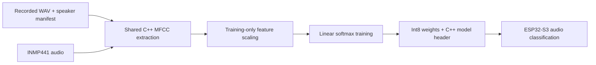

# TinyML Voice Recognition

[](https://github.com/sreekarseera/tinyml-voice-recognition/actions/workflows/checks.yml)

[Architecture](#pipeline-and-model-architecture) · [Quick start](#quick-start-no-microphone-required) · [Recorded speech](#train-with-recorded-speech) · [Energy](#analyze-an-actual-power-trace)

**A small audio-classification pipeline for ESP32-S3, with shared desktop/device features and explicit timing and energy boundaries.**

Recognizing a command on a microcontroller involves more than exporting a model. The recorded audio must match the device input, preprocessing must remain consistent, model weights must fit the implementation, and an energy measurement must identify exactly which work it includes.

This repository makes those stages inspectable. It preserves the supplied microphone and Edge Impulse sketches and provides a separate, reproducible MFCC/linear-classifier baseline with training, model export, device inference and current-trace integration.

## Start here

| Question | Answer |
| --- | --- |
| What does the new baseline classify? | One-second audio windows using labels supplied in a training manifest |
| What hardware does it target? | ESP32-S3 DevKitC-1 with an INMP441 I²S microphone |
| What has passed? | Six automated tests, synthetic-tone training and an ESP32-S3 firmware build on GitHub |
| Is speech accuracy established? | No; the reproducible build check uses generated tones |
| Is energy per inference measured here? | No physical trace is supplied; an integration tool is implemented and tested |
| Where is the core work? | [Features](include/voice_features.h) · [Training](tools/train.py) · [Inference](src/main.cpp) · [Energy](tools/energy.py) |

## Two implementations, clearly separated

| Track | Contents | Scope |
| --- | --- | --- |
| Supplied source | [originals/Firmware/](originals/Firmware/) | Microphone test and Edge Impulse inference sketches, preserved without editing |
| New baseline | src/, include/ and tools/ | Shared MFCC extraction, linear softmax training, int8-weight export and ESP32-S3 inference |

The new baseline is **not** a reproduction of the original report's CNN. Its purpose is to provide a small implementation whose feature extraction, training and device scoring can be read together.

The supplied Edge Impulse SDK/model export is not redistributed here because its embedded terms contain restrictions and public redistribution rights have not been established. The original inference sketch requires that separate library; it is not the default build. The new baseline does not depend on it.

## Pipeline and model architecture



The diagram shows the shared preprocessing design; desktop WAV extraction and microphone capture are separate input paths. The microcontroller uses the same feature-extraction header as the desktop tool.

### Audio and feature extraction

| Parameter | Implementation |
| --- | --- |
| Input window | 16,000 samples: one second at 16 kHz |
| Training format | Mono, 16-bit PCM WAV |
| Frame / hop | 320 samples / 320 samples: 20 ms, without overlap |
| Window function | Hann |
| FFT | 512 points |
| Mel bands | 26, spanning 40–7,600 Hz |
| Cepstral coefficients | 13 per frame |
| Classifier input | Mean and standard deviation of each coefficient: 26 features |

MFCCs summarize the spectral shape of audio. Here, frame-level coefficients are aggregated over the one-second window. This keeps the classifier compact, while discarding the ordering of frames—a deliberate limitation compared with a model that learns time-dependent patterns.

### Training and deployment

The Python trainer calls the shared C++ extractor, fits feature means and standard deviations using **only training examples**, and trains a linear softmax classifier with gradient descent and L2 weight regularization.

It quantizes weights to signed int8 using a shared scale, exports a C++ header, then evaluates those quantized weights separately on the training, validation and test splits. Each split receives an accuracy and confusion matrix.

This is **weight-only quantization**: MFCC extraction, feature normalization, biases and scoring arithmetic remain floating point. It is not a fully integer inference pipeline.

## Engineering decisions you can inspect

| Decision | Why it matters | Evidence |
| --- | --- | --- |
| Share the C++ MFCC implementation | Reduce differences between training and deployment preprocessing | [voice_features.h](include/voice_features.h) |
| Separate speakers across splits | Prevent a speaker appearing in both training and evaluation data | [Manifest validation](tools/train.py) |
| Reject duplicate audio content | Catch exact file duplication, including across splits | [SHA256 checks](tools/train.py) |
| Fit scaling on training data only | Avoid using held-out data to determine the feature transformation | [Training implementation](tools/train.py) |
| Test exported weights in C++ | Check that model export and deployed scoring agree with the Python calculation | [Parity test](tests/test_pipeline.py) |
| Separate capture, DSP and scoring | Make latency and energy intervals interpretable | [Device firmware](src/main.cpp) |
| Integrate real timestamp intervals | Avoid assuming a perfectly uniform power-profiler sample rate | [Energy tool](tools/energy.py) |

These source paths expose work across digital signal processing, dataset validation, numerical model export, embedded integration and measurement design. They do not by themselves establish speech performance or battery life.

## Quick start: no microphone required

Requirements: Python 3.11+, a C++17 compiler available as c++, and PlatformIO Core 6.1.18 for the board build. The Python tools require no third-party packages.

```sh
git clone https://github.com/sreekarseera/tinyml-voice-recognition.git
cd tinyml-voice-recognition
python3 -m unittest discover -s tests -v
python3 tools/synthetic_smoke.py
python3 tools/train.py output/synthetic/manifest.csv --data-kind synthetic
python3 -m pip install platformio==6.1.18
pio run
```

This generates six WAV files: two tone classes across three distinct synthetic groups, one group per split. It exercises feature extraction, training, export and compilation. Any accuracy reported by this run describes **tone discrimination in that small software fixture**, not voice recognition.

The generated model header is required for compilation. The repository deliberately does not ship a pre-trained speech model or silently substitute one.

## Train with recorded speech

Prepare consented recordings with exactly one second of mono, 16-bit PCM audio at 16 kHz. The trainer rejects files that do not match this format; it does not automatically crop, pad or resample them.

Create recordings/manifest.csv using this schema:

```csv
path,label,speaker,split
```

| Column | Meaning |
| --- | --- |
| path | WAV path relative to the manifest's directory |
| label | Class identifier, 1–32 ASCII letters, digits, underscores or hyphens |
| speaker | Stable identifier for the person or recording source |
| split | train, validation or test |

Every split must contain every class, with at least two training classes overall. Speaker identifiers cannot cross splits, and repeated file contents are rejected. For a noise class, also keep recording sessions/sources separated; the code's identifier check cannot establish acoustic independence on its own.

```sh
python3 tools/train.py recordings/manifest.csv --data-kind recorded
```

The default is 150 training epochs; --epochs changes that setting. The command writes:

| Artifact | Contents |
| --- | --- |
| include/trained_model.h | Labels, feature scaling, quantized weights, bias and dataset-kind label |
| output/training-report.json | Model parameters, per-split evaluation, manifest hash and audio hashes |
| output/extract_features | Compiled desktop feature-extraction helper |

Recorded voices, generated models and output files are excluded by [the Git ignore rules](.gitignore). After the tone demonstration, retrain before a voice demonstration; the training command replaces the generated model header.

## Device interface and timing

| Connection | ESP32-S3 pin / setting |
| --- | --- |
| INMP441 SCK / BCLK | GPIO 14 |
| INMP441 WS / LRCLK | GPIO 15 |
| INMP441 SD | GPIO 16 |
| Microphone supply | 3.3 V and common ground |
| Audio channel | Left channel; configure the microphone's L/R selection accordingly |
| MFCC profiling output | GPIO 4 |
| Linear-scoring profiling output | GPIO 5 |

Confirm the pinout and supported voltage levels for the actual board. The firmware reads 32-bit I²S words, shifts them to a normalized 16-bit scale and fills a one-second audio buffer.

```sh
pio run -t upload
pio device monitor
```

The serial monitor uses 115200 baud and prints:

```csv
capture_us,dsp_us,nn_us,label,probability
```

Despite the field name nn_us, that interval covers the new baseline's **linear scoring**, excluding softmax normalization and serial output. GPIO 4 brackets MFCC extraction; GPIO 5 brackets scoring. There is no intentional pulse-widening delay in the new firmware.

The supplied original inference sketch retains its 100 ms debugging delay in originals/, making the difference inspectable. Do not treat a pulse containing that delay as isolated neural-network execution.

Capture, processing and output happen sequentially; this implementation is not a gapless streaming or overlapping-window recognizer. The reported probability is a softmax output, not a calibrated confidence or an automatic unknown-command rejection rule.

## Analyze an actual power trace

Select the intended interval using the profiling signals, export its samples and convert the CSV column names/units to:

```csv
time_s,current_ma
```

Then run:

```sh
python3 tools/energy.py selected-trace.csv --voltage 3.3 --baseline-ma 0
```

The tool uses trapezoidal integration over the supplied timestamps:

**Energy (mJ) = supply voltage (V) × integral of current (mA) over time (s).**

It reports total energy, baseline-subtracted energy, mean current and duration. The voltage argument must represent the measured, approximately constant supply. Baseline subtraction is reported separately and is not clamped to zero.

Select DSP, scoring or a complete capture/processing cycle intentionally. The tool does not automatically detect GPIO boundaries, account for a varying supply or infer battery life.

## Verification, limitations and next experiments

The six tests cover MFCC execution on silence and a tone, Python/exported-C++ scoring agreement, exact-duplicate rejection, energy units, irregular time intervals and invalid trace inputs. GitHub also trains the synthetic fixture and compiles the ESP32-S3 baseline.

See the [workflow](.github/workflows/checks.yml) and [verification record](VERIFICATION.md). Neither the supplied Edge Impulse implementation nor a physical voice/power measurement is validated by that build.

The next evidence to collect is:

1. Device-microphone recordings across held-out speakers and rooms.
2. Quantized-model evaluation on those recordings, including false activations and rejected/unknown sounds.
3. Timestamped current traces for clearly identified processing intervals.
4. Comparison of desktop and device features on the same captured audio.

These are remaining experiments, not completed results. No speech-accuracy, sub-millijoule-energy or battery-life claim is made by this repository.

## Repository map and attribution

| Path | Purpose |
| --- | --- |
| [include/voice_features.h](include/voice_features.h) | Portable FFT, mel filtering and MFCC statistics |
| [include/classifier.h](include/classifier.h) | Shared quantized-weight scoring |
| [tools/train.py](tools/train.py) | Dataset checks, training, export and evaluation |
| [src/main.cpp](src/main.cpp) | I²S acquisition, profiling signals and inference |
| [tools/energy.py](tools/energy.py) | Current-trace integration |
| [tools/synthetic_smoke.py](tools/synthetic_smoke.py) | Explicitly synthetic build fixture |
| [originals/Firmware/](originals/Firmware/) | Supplied microphone and inference sketches |
| [SOURCE_MANIFEST.json](SOURCE_MANIFEST.json) | Hashes of preserved supplied files |

The new baseline was prepared with AI assistance on 29 October 2026 and is not represented as earlier student-authored code. Supplied files and new work are distinguished in [docs/attribution.md](docs/attribution.md). Read [LICENSE.md](LICENSE.md) before reusing material.
